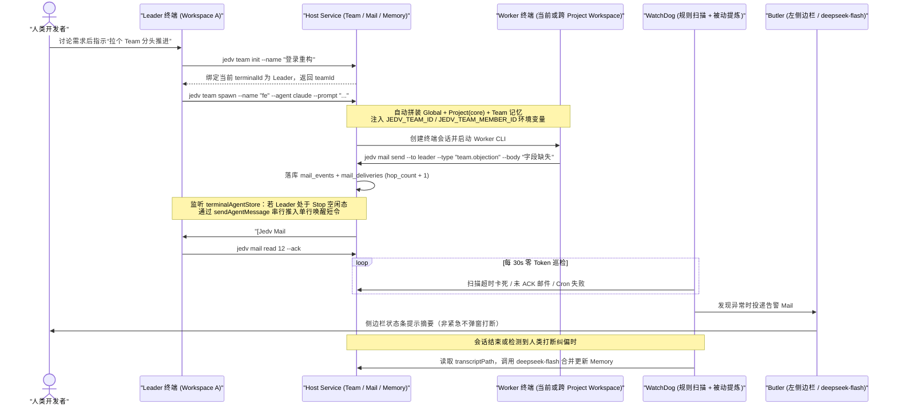

# Jedv 总体架构与分阶段工程实施计划（定稿版）

> [!IMPORTANT]
> **产品核心定位**：基于 Paradev 二次开发的本地优先 ADE。剥离云服务、会员、浏览器与语音等冗余噪音，聚焦**“终端原生多 Agent 团队协作（Teamwork）+ 异步事件邮箱（Mail）+ 分层记忆（Memory）+ 看门狗与管家降噪（WatchDog & Butler）”**，只把真正需要人类拍板的信息推到台前。

---

## 一、已拍板的核心设计决策汇总

1. **交互主次关系**：日常工作仍以 **Workspace + 终端** 为主场；**Butler** 在**左侧边栏底部**折叠常驻，绝不喧宾夺主或遮挡终端区。
2. **统一 `Mail` 模型**：Event、Message 与 Mailbox 彻底合一为 `mail`。底层采用“不可变事件表 + 收件箱投递表”，对外统一暴露 `jedv mail` 与 OpenAPI，同时服务于内部 Agent 通信与未来的外部 Event Provider。
3. **纯终端载体 + 原地建队**：Leader 与 Worker 均为真实的终端 Agent 会话（挂载于 `terminal_sessions` + `terminal_agent_bindings`）。平时单兵对话，任务变复杂时在终端内通过 `jedv team init` **原地晋升为 Leader**，再通过 `jedv team spawn` 拉起 Worker。
4. **灵活的跨项目 / 同项目 Spawn 规则**：
   - 传 `--workspace <id>`：在指定的已有 Workspace 中新拉一个 Worker 终端；
   - 不传 `--workspace`（默认）：若未指定跨项目，直接在**当前 Workspace** 新拉一个 Worker 终端；若传了 `--project <id>`，自动在目标 Project 下新建一个独立 Worktree Workspace 并在其中拉起 Worker（以此自然解决多仓库协作，无需改造单 Repo Project 底层）。
5. **双入口 Teamwork 可视化**：
   - **局部入口**：Workspace 卡片（[JedvWorkspaceRow.tsx](file:///Users/djj/.paradev/worktrees/jedv/DJJ/paradev-fork-9ae58433/apps/desktop/src/renderer/components/JedvShell/components/JedvWorkspaceRow/JedvWorkspaceRow.tsx#L467)）底部 `{agentChips}` 右侧显示紧凑 Teamwork 徽章，点击直达所属 Team Dashboard；
   - **全局入口**：左侧顶部导航（[JedvSidebarNav.tsx](file:///Users/djj/.paradev/worktrees/jedv/DJJ/paradev-fork-9ae58433/apps/desktop/src/renderer/components/JedvShell/components/JedvSidebarNav/JedvSidebarNav.tsx#L39-L64)）常驻 `Teamwork` 视图，总览所有涉及的 Project / Workspace / Leader / Worker。
6. **三层 Memory 隔离**：`global`（个人习惯）+ `project`（项目规范，支持 `.jedv/memory.json` 导出）+ `team`（本次跨项目协作短期共享黑板，Team 归档即封存，不污染后续任务）。
7. **极简模型配置**：Settings 页面仅为内部系统智能体（Butler & WatchDog）提供一个极简的 **DeepSeek API Key 单输入框**，内部固定对接 `deepseek-flash`，不暴露多余的复杂参数表单。

---

## 二、全链路运行时序（从原地组队到唤醒与记忆沉淀）

---

## 三、数据库增量设计（`packages/host-service/src/db`）

> [!NOTE]
> 所有变更以新增迁移文件加入 `packages/host-service`，保留 [schema.ts](file:///Users/djj/.paradev/worktrees/jedv/DJJ/paradev-fork-9ae58433/packages/host-service/src/db/schema.ts) 全部既有表结构兼容，不使用外部原生 C 扩展，确保生产 Node `better-sqlite3` 与测试 `bun:sqlite` 100% 一致运行。

### 1. `host_settings` 增量列
- 在现有 [hostSettings](file:///Users/djj/.paradev/worktrees/jedv/DJJ/paradev-fork-9ae58433/packages/host-service/src/db/schema.ts#L137-L146)（或系统凭证存储）新增：
  - `deepseek_api_key`: `text`（存储用户填写的唯一 API Key，向前端返回时脱敏为 `hasDeepseekApiKey: boolean` + 尾号掩码）。

### 2. `teams` 与 `team_members` 表
- **`teams`**
  - `id`: `text` PK (UUID)
  - `name`: `text` NOT NULL
  - `goal`: `text`
  - `status`: `text` NOT NULL (`'active' | 'paused' | 'completed' | 'archived'`)
  - `origin_workspace_id`: `text`（发起 `team init` 的初始 Workspace）
  - `created_at` / `updated_at` / `archived_at`: `integer`
- **`team_members`**
  - `id`: `text` PK (UUID)
  - `team_id`: `text` NOT NULL FK -> `teams.id` (`ON DELETE CASCADE`)
  - `name`: `text` NOT NULL（团队内唯一短名，如 `leader`, `worker-1`, `fe-worker`，建联合唯一索引 `(team_id, name)`）
  - `role`: `text` NOT NULL (`'leader' | 'worker'`)
  - `host_id`: `text` NOT NULL DEFAULT `'local'`
  - `project_id`: `text`（允许为空以兼容无项目空文件夹 Workspace）
  - `workspace_id`: `text` NOT NULL
  - `terminal_id`: `text`（关联 `terminal_sessions.id`，`ON DELETE SET NULL`）
  - `agent_id`: `text`（如 `claude`, `codex`, `agy`）
  - `task_summary`: `text`（分配给该 Worker 的初始职责摘要，供 Dashboard 展示）
  - `joined_at` / `ended_at`: `integer`
  - 索引：`idx_team_members_workspace(workspace_id)`, `idx_team_members_terminal(terminal_id)`

### 3. `mail_events` 与 `mail_deliveries` 表
- **`mail_events`**（不可变事实表，兼容 CloudEvents 语义）
  - `id`: `text` PK (UUID / ULID，按时间有序)
  - `type`: `text` NOT NULL（如 `'agent.message'`, `'team.task'`, `'team.objection'`, `'watchdog.alert'`, `'cron.failed'`, `'provider.*'`）
  - `source_kind`: `text` NOT NULL (`'member' | 'butler' | 'watchdog' | 'human' | 'provider'`)
  - `source_id`: `text` NOT NULL
  - `host_id`: `text` NOT NULL DEFAULT `'local'`
  - `workspace_id`: `text`
  - `team_id`: `text`
  - `thread_id`: `text`（串联多轮协商回复）
  - `dedupe_key`: `text`（可选幂等键，防重复投递）
  - `hop_count`: `integer` NOT NULL DEFAULT `0`（自动唤醒链每回复一次递增，默认 `>= 8` 熔断）
  - `subject`: `text`
  - `body`: `text` NOT NULL DEFAULT `''`
  - `payload_json`: `text`（结构化扩展负载）
  - `created_at`: `integer` NOT NULL
  - 索引：`idx_mail_events_team_created(team_id, created_at)`, `idx_mail_events_thread(thread_id)`
- **`mail_deliveries`**（收件箱状态与消费指针表）
  - `id`: `text` PK
  - `event_id`: `text` NOT NULL FK -> `mail_events.id` (`ON DELETE CASCADE`)
  - `recipient_kind`: `text` NOT NULL (`'member' | 'agent_terminal' | 'butler' | 'human_inbox'`)
  - `recipient_id`: `text` NOT NULL
  - `target_host_id`: `text` NOT NULL DEFAULT `'local'`（跨 Host 时作为 Outbox 转发目标）
  - `status`: `text` NOT NULL (`'unread' | 'nudged' | 'read' | 'acked' | 'dead'`)
  - `attempt_count`: `integer` NOT NULL DEFAULT `0`
  - `next_attempt_at`: `integer`
  - `created_at` / `nudged_at` / `read_at` / `acked_at`: `integer`
  - 索引：`idx_mail_deliveries_recipient_status(recipient_kind, recipient_id, status)`

### 4. `memories` 表 + `memories_fts` 全文检索表
- **`memories`**
  - `id`: `text` PK
  - `scope_kind`: `text` NOT NULL (`'global' | 'project' | 'team'`)
  - `scope_id`: `text` NOT NULL DEFAULT `''`（`global` 时为空串，避免 SQLite NULL 唯一约束陷阱）
  - `tier`: `text` NOT NULL (`'core' | 'archival'`)
  - `category`: `text` NOT NULL (`'correction' | 'convention' | 'pitfall' | 'context' | 'summary'`)
  - `title`: `text` NOT NULL
  - `content`: `text` NOT NULL
  - `source_kind`: `text` NOT NULL (`'agent' | 'watchdog' | 'butler' | 'human'`)
  - `source_ref`: `text`（来源 `terminalId` 或 `mailEventId`）
  - `superseded_by_id`: `text`（非空代表已被新记忆覆盖淘汰，默认查询与注入过滤掉非空行）
  - `created_at` / `updated_at`: `integer` NOT NULL
  - 索引：`idx_memories_scope_tier(scope_kind, scope_id, tier)`
- **`memories_fts`**：基于 SQLite 内置 `FTS5` 建立在 `(title, content)` 上的外部内容虚拟表，通过 SQLite Trigger 与 `memories` 保持同步。

---

## 四、CLI、环境变量与 OpenAPI 接口契约

### 1. 终端自动注入环境变量
在 [env.ts](file:///Users/djj/.paradev/worktrees/jedv/DJJ/paradev-fork-9ae58433/packages/host-service/src/terminal/env.ts) 与 `team spawn` 启动路径中，除原有的 `JEDV_WORKSPACE_ID`、`JEDV_TERMINAL_ID` 外，为 Team 成员注入：
- `JEDV_TEAM_ID`：所属 Team UUID
- `JEDV_TEAM_MEMBER_ID`：当前成员 UUID
- `JEDV_TEAM_MEMBER_NAME`：成员短名（如 `leader`, `fe-worker`）
- `JEDV_TEAM_ROLE`：`leader` 或 `worker`

> [!TIP]
> 对于**原地晋升**（`jedv team init`）的 Leader 终端：由于 shell 进程已启动无法回写父进程 env，`host-service` 通过 `(workspaceId, terminalId)` 在 `team_members` 表中反查当前终端身份！因此 Leader 后续运行 `jedv team spawn` 或 `jedv mail send` 时无需手动传 `--team`，CLI 直接凭 `JEDV_TERMINAL_ID` 自动识别身份。

### 2. CLI 命令详单（`packages/cli/src/commands`）

| 命令 | 参数与默认行为 | 说明 |
| :--- | :--- | :--- |
| `jedv team init` | `--name <str>` `[--goal <str>]` | 将当前终端（由 `JEDV_TERMINAL_ID` 定位）注册为新建 Team 的 `leader` |
| `jedv team spawn` | `--name <member>` `--agent <preset>` `--prompt <task>` `[--workspace <ws-id>]` `[--project <proj-id>]` `[--branch <name>]` `[--model <m>]` | **默认行为**：① 传了 `--workspace` 则在该 Workspace 拉起新终端 Worker；② 未传 `--workspace` 且未传 `--project`，直接在**当前 Workspace** 新拉一个 Worker 终端；③ 传了 `--project` 未传 `--workspace`，调用 [workspace-creation](file:///Users/djj/.paradev/worktrees/jedv/DJJ/paradev-fork-9ae58433/packages/host-service/src/trpc/router/workspace-creation) 在目标项目自动创建新 Worktree 后拉起 Worker |
| `jedv team status` | `[--team <id>]` | 返回 Team 详情、所有成员终端运行态（`Start/Stop/PermissionRequest/Failed`）及未读邮件数 |
| `jedv team list` | `[--status active\|all]` | 列出所有 Team |
| `jedv team rename` | `--name <new-name>` `[--team <id>]` | 重命名 Team |
| `jedv team stop` | `[--member <name>]` `[--team <id>]` | 优雅结束指定 Worker 或归档整个 Team（同时封存该 Team 短期黑板记忆） |
| `jedv mail send` | `--to <member\|leader\|butler\|team>` `--body <text>` `[--subject <s>]` `[--type <t>]` `[--payload <json>]` `[--reply-to <id>]` `[--host <h>]` | 发送点对点消息、异议或团队广播事件 |
| `jedv mail inbox` | `[--status unread\|all]` `[--limit 20]` | 查看当前成员（或指定 `--team`）收件箱列表 |
| `jedv mail read` | `<delivery-id>` `[--no-ack]` | 读取邮件完整内容与 JSON 负载（默认读取即标记 `read`，传 `--ack` 直接确认处理完毕） |
| `jedv mail ack` | `<delivery-id>` | 显式标记消费完成，消除 WatchDog 积压计时 |
| `jedv mail watch` | `[--team <id>]` `[--agent <id>]` `[--timeout <sec>]` | 先输出当前未读邮件，随后挂载 WebSocket 阻塞流式输出新到达事件 |
| `jedv memory put` | `--content <text>` `[--title <t>]` `[--scope team\|project\|global]` `[--tier core\|archival]` `[--category <c>]` | 主动写入记忆（在 Team 内默认 `scope=team` 或 `project`） |
| `jedv memory search` | `<query>` `[--scope ...]` `[--limit 10]` | 基于 SQLite `FTS5` 检索相关记忆 |
| `jedv memory list` | `[--scope ...]` `[--tier core\|archival]` | 查看当前生效记忆列表 |
| `jedv memory delete` | `<memory-id>` | 删除或标记废弃错误记忆 |
| `jedv memory export` | `[--out <path>]` `[--scope project]` | 导出结构化 JSON（默认可输出至项目 `.jedv/memory.json`） |
| `jedv memory import` | `--file <path>` | 从 JSON 导入并按内容去重合并 |

### 3. OpenAPI 轻量 HTTP 接口（挂载于 `packages/host-service/src/app.ts`）
共用现有 `providers.hostAuth`（Bearer PSK 鉴权），供 Worker 程序化访问及未来外部 Event Provider 推送：
- `POST /api/v1/mail`（发送消息/外部 Provider 注入 Event）
- `GET /api/v1/mail/inbox` & `POST /api/v1/mail/:id/ack`
- `GET /api/v1/memory`（查询/搜索） & `POST /api/v1/memory`（写入） & `GET /api/v1/memory/export`

---

## 五、分阶段实施路线图（M1 ~ M5）

每个里程碑均可独立闭环测试与交付，互不阻塞：

### Milestone 1：`Mail` 底座 + `Team` 核心编排与 CLI（后端 + CLI 闭环）
- **目标**：不依赖新 UI，纯在现有终端里就能体验“Claude 原地 `jedv team init` -> `jedv team spawn` 拉起队友 -> `jedv mail` 互相通信与自动空闲唤醒”。
- **改造与新增文件清单**：
  1. **DB Schema & Migration**：在 [packages/host-service/src/db/schema.ts](file:///Users/djj/.paradev/worktrees/jedv/DJJ/paradev-fork-9ae58433/packages/host-service/src/db/schema.ts) 增加 `teams`、`team_members`、`mail_events`、`mail_deliveries` 表，生成 SQLite 迁移并在 `migrations.test.ts` 补齐测试。
  2. **Mail 服务与唤醒器**：新建 `packages/host-service/src/mail/`（收发存储、线程关联、`hop_count` 防死循环拦截、监听 `terminalAgentStore` 空闲状态调用 `sendAgentMessage` 发送单行唤醒提示）。
  3. **Team 服务**：新建 `packages/host-service/src/teams/`（原地绑定 `terminalId`、同 Workspace / 指定 Workspace / 跨 Project 自动建 Worktree 三种 Spawn 分支、成员状态聚合）。
  4. **EventBus 通知扩展**：在 [events/types.ts](file:///Users/djj/.paradev/worktrees/jedv/DJJ/paradev-fork-9ae58433/packages/host-service/src/events/types.ts) 增加轻量的 `team:changed` 与 `mail:changed` 广播消息。
  5. **tRPC & OpenAPI 路由**：在 [trpc/router/router.ts](file:///Users/djj/.paradev/worktrees/jedv/DJJ/paradev-fork-9ae58433/packages/host-service/src/trpc/router/router.ts) 注册 `team` 与 `mail` 路由；在 [app.ts](file:///Users/djj/.paradev/worktrees/jedv/DJJ/paradev-fork-9ae58433/packages/host-service/src/app.ts) 挂载 `/api/v1/mail`。
  6. **CLI 命令与内置 Skill**：在 `packages/cli/src/commands/` 新增 `team/` 与 `mail/` 命令目录；在 [packages/agent-setup/src/managed-skills.ts](file:///Users/djj/.paradev/worktrees/jedv/DJJ/paradev-fork-9ae58433/packages/agent-setup/src/managed-skills.ts) 注册内置 `jedv-team` Skill（教会所有 CLI Agent 何时及如何使用 `jedv team` 与 `jedv mail`）。
- **验收标准（DoD）**：
  - 在终端 A 运行 `jedv team init` 后，执行 `jedv team spawn` 能成功拉起终端 B 并自动开始执行任务；
  - 终端 B 执行 `jedv mail send --to leader` 后，若终端 A 空闲则自动收到唤醒指令，若终端 A 忙碌则在 `Stop` 事件触发后收到唤醒；
  - 模拟两个测试终端互相自动回信达到 `hop_count = 8` 时触发熔断停止唤醒。

---

### Milestone 2：桌面端 `Teamwork` 双入口与 Dashboard + 空目录项目支持
- **目标**：人类无需敲命令即可在侧边栏一眼识别哪些 Workspace 正在组队运行，点进看板总览跨项目协作全局并一键跳转终端。
- **改造与新增文件清单**：
  1. **Workspace 右下角徽章**：在 [JedvProjectTree](file:///Users/djj/.paradev/worktrees/jedv/DJJ/paradev-fork-9ae58433/apps/desktop/src/renderer/components/JedvShell/components/JedvProjectTree) 与 [JedvWorkspaceRow.tsx](file:///Users/djj/.paradev/worktrees/jedv/DJJ/paradev-fork-9ae58433/apps/desktop/src/renderer/components/JedvShell/components/JedvWorkspaceRow/JedvWorkspaceRow.tsx#L467) 的 `{agentChips}` 行右侧渲染 Teamwork 胶囊徽章（支持点击跳转对应 Team）。
  2. **左侧导航入口**：在 [JedvSidebarNav.tsx](file:///Users/djj/.paradev/worktrees/jedv/DJJ/paradev-fork-9ae58433/apps/desktop/src/renderer/components/JedvShell/components/JedvSidebarNav/JedvSidebarNav.tsx#L39-L64) 与 `JedvSurface` 类型中增加 `teamwork` 导航项。
  3. **Teamwork Dashboard 组件**：新建 `JedvTeamworkView/JedvTeamworkView.tsx`：
     - 左侧/顶部切换不同活跃或已归档 Team（支持内联重命名、暂停唤醒、归档）；
     - **成员拓扑网格**：按 Leader / Worker 卡片展示所属 `Project / Workspace`、实时状态灯（Working / Idle / Blocked / Failed）、任务摘要，点击卡片一键切回对应 Workspace 并聚焦该终端 Pane；
     - **实时 Mail 协作时间线**：展示成员间的任务派发、异议协商与 ACK 状态，底部提供人类直接向 Leader 或指定 Worker 发信的快捷输入框。
  4. **空 Folder Project 支持**：放宽项目添加时的 `.git` 强校验（标记无 Git 目录类型的 Project，自动禁用该项目的分支/PR 同步轮询，正常支持终端与 Team 运行）。
- **验收标准（DoD）**：
  - 跨 2 个 Project 组建的 Team，在两个 Workspace 行右下角均显示徽章；
  - 在 Dashboard 点击任一跨项目 Worker 可精确跳转并聚焦其真实终端；
  - 所有新增文案通过 `bun run check:i18n` 校验，GUI 实测暗色/亮色主题排版无溢出。

---

### Milestone 3：三层 `Memory` 系统 + DeepSeek 接入 + `WatchDog` 引擎
- **目标**：打通主动/被动双通道记忆闭环与零噪音后台看门狗。
- **改造与新增文件清单**：
  1. **Settings 极简配置**：在 [JedvSettingsView.tsx](file:///Users/djj/.paradev/worktrees/jedv/DJJ/paradev-fork-9ae58433/apps/desktop/src/renderer/components/JedvShell/components/JedvSettingsView/JedvSettingsView.tsx) 增加 `DeepSeek API Key` 密码输入框（仅此一项，保存至 `host-service`）。
  2. **DeepSeek 轻量客户端**：在 `packages/host-service/src/ai/` 封装极简 HTTP 客户端（固定指向 DeepSeek 官方兼容端点与 `deepseek-flash` 模型，未配置 API Key 时优雅降级为仅运行主动记忆与纯规则 WatchDog，绝不影响主流程）。
  3. **Memory 存储与检索**：新增 `memories` + `memories_fts` 迁移；实现 `packages/host-service/src/memory/`（CRUD、`FTS5` 搜索、JSON 导入导出、容量预算裁剪）；上线 `jedv memory` CLI 与 `/api/v1/memory`；在 Teamwork Dashboard 增加“Team 共享黑板”面板，在项目设置/侧边栏支持查看与删除 Project Memory。
  4. **Worker 启动注入**：在 `team spawn` 组装初始引导上下文时，自动注入 `[Global Core] + [Project Core] + [Team Blackboard]` 记忆块（严格限制总注入长度在预算内）及 `jedv memory search` 提示。
  5. **WatchDog 服务**：新建 `packages/host-service/src/watchdog/`：
     - **30s 规则巡检（0 Token）**：检查超时无进展的活跃成员（结合 `terminalAgentStore` 与 `gitWatcher` 区分“真卡死”与“正常长任务”）、超时未消费的 `mail_deliveries`、[LocalAutomations](file:///Users/djj/.paradev/worktrees/jedv/DJJ/paradev-fork-9ae58433/packages/host-service/src/automations/automations.ts) 失败运行，生成去重后的告警投递至 `butler` 邮箱；
     - **被动记忆提取**：监听终端会话结束或用户中断纠偏信号，异步读取 `transcriptPath` 最近片段调用 `deepseek-flash`，对 `memories` 执行 `ADD / UPDATE / SUPERSEDE`。
- **验收标准（DoD）**：
  - 未填写 DeepSeek Key 时，主动 `jedv memory`、启动注入与规则 WatchDog 100% 正常工作；
  - 填写 Key 后，模拟人类在对话中纠正规范并结束会话，WatchDog 能自动提取更新 Project Memory 且旧冲突条目被标记 `superseded_by_id`；
  - Team 归档后，其 `scope=team` 的黑板记忆不再注入给同项目后续新建的其他 Team。

---

### Milestone 4：左侧边栏常驻 `Butler` 管家
- **目标**：人类可通过左侧边栏常驻的 Butler 一站式查询所有项目/Team/Cron 进展、整理记忆、重命名或代发指令给各 Team Leader。
- **改造与新增文件清单**：
  1. **Butler Agent Runtime**：新建 `packages/host-service/src/butler/`，基于 `deepseek-flash` 绑定受控内部 Tool 集：
     - **直接执行类（Safe Tools）**：`listWorkspaces`、`createWorkspace`、`listTeams`、`getTeamStatus`、`renameTeam`、`renameWorkspace`、`sendMailToLeader`（强制附带人类原话字段防传话失真）、`getCronStatusAndErrors`、`listAndCurateMemories`。
     - **需人类审批类（Guarded Tools）**：`archiveWorkspace`、`stopTeam`、`deleteMemoryBatch` —— 调用时仅向前端返回待确认 Action Card，用户点击“确认”后才真正落库执行。
  2. **左侧边栏底部抽屉 UI**：新建 `JedvButlerDock/JedvButlerDock.tsx`，挂载于 [JedvSidebarNav.tsx](file:///Users/djj/.paradev/worktrees/jedv/DJJ/paradev-fork-9ae58433/apps/desktop/src/renderer/components/JedvShell/components/JedvSidebarNav/JedvSidebarNav.tsx#L113) 底部状态栏上方：
     - 折叠态：单行显示 WatchDog 未读汇报角标与快捷唤醒入口；
     - 展开态：在左侧栏下半区呈现轻量对话流与审批确认卡片，面板折叠/高度状态按有界规则存入本地设置。
- **验收标准（DoD）**：
  - 通过 Butler 可准确查出失败的 Cron 任务、重命名指定 Team、向指定 Team Leader 投递任务补充说明并收到 Leader 回信汇总；
  - 让 Butler 删除/归档 Workspace 时，必定拦截并展示确认按钮，未点击前不发生任何破坏性副作用。

---

### Milestone 5：跨 Host 协同 + Tailscale Mobile PWA + P2 插件插槽
- **目标**：将本机闭环的能力平滑延伸至多机 Tailscale 私网与手机随身管控。
- **改造与新增文件清单**：
  1. **跨 Host `Mail` 转发**：在 `host-service` 增加 `peer_hosts` 配置与后台 Outbox Forwarder，复用现有 Tailscale `.ts.net` HTTPS + Bearer PSK 校验（见 [private-connections.mdx](file:///Users/djj/.paradev/worktrees/jedv/DJJ/paradev-fork-9ae58433/llmdoc/runtime/private-connections.mdx)），将 `target_host_id != local` 的 `mail_deliveries` 可靠投递至远端主机 `/api/v1/mail/ingest`。
  2. **简单实用的 Mobile PWA**：在 `host-service` 挂载轻量移动端静态路由 `/mobile`（共用 PSK 登录态），仅提供 **Butler 聊天、WatchDog/审批收件箱、Team/Cron 状态概览** 三屏界面。
  3. **Plugin 固定插槽 (P2)**：定义受控的声明式插槽契约（如 `teamwork.header`、`sidebar.panel`、`mail.provider`），仅通过公开的 OpenAPI / 受限 SDK 交互，不允许任意篡改宿主 DOM。

---

## 六、开发纪律与工程红线（遵循 `AGENTS.md`）

1. **目录与组件规范**：所有新增 React 组件严格遵守 `Name/Name.tsx` + `index.ts` 单组件单文件结构，Hooks、辅助函数与单测就近共置（Co-locate）。
2. **保护用户现场与数据**：所有开发测试必须使用独立临时 Profile 与临时仓库，严禁触碰 `~/.jedv` 真实用户数据或终止活跃终端。
3. **测试质量要求**：单测必须快速、隔离、顺序无关，禁止使用真实 `setTimeout` 死等（WatchDog 定时器通过注入可控 `Clock` 测试），且桌面 UI 变更必须配合真实 GUI 验证。
4. **多语言完备性**：所有新增用户可见文案使用 Lingui 英文 Message ID，同步更新翻译并确保 `bun run check:i18n` 与 `bun run typecheck` 零报错通过。
